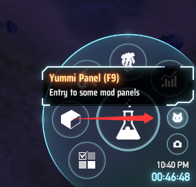
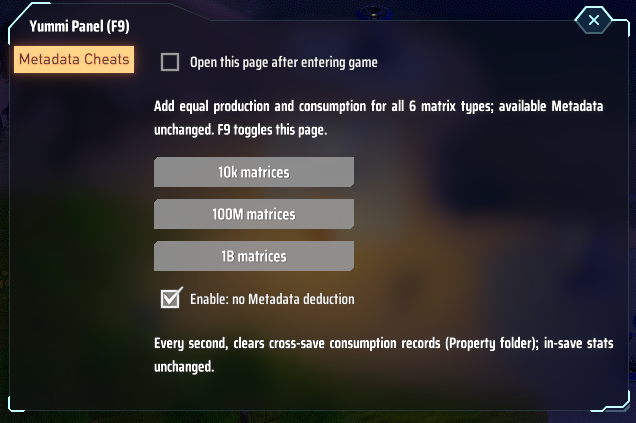

# CatUIPanel

Thunderstore 本地上传 zip（可点击）：[THUNDERSTORE_ZIPS.md](THUNDERSTORE_ZIPS.md)

<details>
<summary>English</summary>

**A shared in-game panel for Dyson Sphere Program mods.** A white cat button sits right above the screenshot button in the bottom-right corner; clicking it opens one window where every registered mod has its own tab.

This mod gives mod authors a shared, lightweight panel with no other gameplay features bundled in.
Unfortunately, the panel is still an alpha prototype for now.





## For players

- Press **F9** or click the cat button (or the window's close button / Esc) to open and close the panel.
- If the cat button overlaps something, move it with `Launcher/OffsetX` and `Launcher/OffsetY` in the config file.

## For mod authors

```csharp
[BepInDependency(CatUIPanel.UIPanel.Guid)]
public class MyPlugin : BaseUnityPlugin
{
    private void Awake()
    {
        ConfigEntry<bool> autoOpen = Config.Bind("General", "AutoOpen", true, "...");
        CatUIPanel.UIPanel.RegisterPage("我的功能")
            .AddCheckbox(autoOpen, "进入游戏后自动打开")
            .AddButton("执行", () => DoSomething())
            .AddLabel("说明文字");
    }
}

// whenever your mod needs the user's attention:
CatUIPanel.UIPanel.OpenPage("我的功能");
```

- Register in `Awake`; the window is built the first time it is opened in a game.
- Checkboxes read and write the `ConfigEntry` directly, so the value is saved in your own cfg and stays in sync with other editors.
- `OpenPage(id)` opens the panel on that tab. Called outside a game (main menu, loading), it waits until a game is entered; leaving a game cancels it.
- `RegisterPage(key)`：`key` 是唯一标识，也是左侧分页标题；**多个 mod 用同一个 key 会合并到同一页**（后加载的 mod 在下方追加控件）。
- `TogglePage(key)`, `Close()`, `IsOpen`, `CurrentPageKey`；`UIPanel.ApiVersion` 现为 3。

</details>

<details>
<summary>中文</summary>

**戴森球计划 mod 内的游戏内面板。** 
右下角截图按钮正上方有一个白色小猫按钮，点开是一个窗口，每个注册过的 mod 占左侧一个分页。
这个 mod 旨在给 mod 作者们提供一个公共的、不含其他功能的轻量级面板。
虽然很遗憾，到目前为止，这个面板仍然是 alpha 原型阶段。


## 玩家

- 按 **F9** 或点小猫按钮打开/关闭面板；窗口关闭按钮或 Esc 也能关闭。
- 小猫按钮如果挡住了别的东西，可在配置文件里用 `Launcher/OffsetX`、`Launcher/OffsetY` 挪位置。

## mod 作者

用法见上文 English 节的代码示例。

- 在 `Awake` 里注册；窗口在游戏中第一次打开时才生成。
- 复选框直接读写 `ConfigEntry`，值保存在你自己 mod 的 cfg 里，和其他配置编辑器保持一致。
- `OpenPage(id)` 打开面板并切到该页。在主菜单、读档中调用时会排队，进入游戏后再打开；离开游戏时取消排队。
- 另有 `TogglePage(key)`、`Close()`、`IsOpen`、`CurrentPageKey`。`UIPanel.ApiVersion` 现为 3。

## 中国用户特殊说明

- 有问题可以直接来我QQ群问我，目前群为629176031。

</details>
